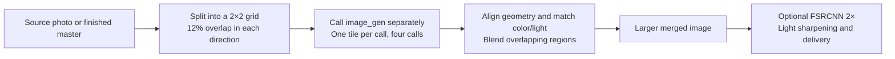

# Open Photo Workflow

[中文](README.md) · English

**Split a photo into four tiles, edit each with `image_gen`, then align and stitch the results into a larger image.** This is the main technique we want to share, and a practical way to put your ChatGPT Pro image-generation allowance to work.

In our Codex built-in `image_gen` runs, we repeatedly received **1536×1024** landscape or **1024×1536** portrait outputs, about 1.57 megapixels. That can be too small when editing high-resolution camera photographs. Giving each call only part of the photograph, then combining four outputs, reduces the constraint of a single whole-image output.

1536×1024 is a common size observed in this project, not a claim that every model or version has a fixed limit. The workflow uses the dimensions the tool actually returns.

## The core technique: generate four tiles, stitch, then upscale



1. **Split.** Keep the aspect ratio and create top-left, top-right, bottom-left, and bottom-right tiles. Overlap is 12% of the full image's corresponding dimension, leaving room for alignment and blending.
2. **Generate separately.** Send each tile to `image_gen` with the same photographic goal. Use the tile alone by default; add a full-image reference when context is necessary. Calls may run in parallel when the host supports it.
3. **Align and stitch.** Align geometry, match color and brightness across overlaps, and blend the edges. Compute the merged dimensions from the actual tile outputs; do not first resize or pad to a fixed 4K canvas.
4. **Upscale after merging.** When a larger delivery is needed, apply FSRCNN 2× to the merged image, followed by light sharpening. The final long edge can exceed 4K.

For a 3:2 landscape photo with 12% overlap and four 1536×1024 tile outputs, the geometric estimate is:

| Stage | Example dimensions |
| --- | --- |
| One whole-image generation | 1536×1024, about 1.57 MP |
| Four aligned and merged tiles | About 2743×1829, about 5.02 MP |
| FSRCNN 2× after merging | About 5486×3658, about 20.07 MP |

These are calculated examples, not guaranteed generation results. Overlapping pixels count once. Actual dimensions depend on the source ratio, crop rounding, and returned tile sizes. More output pixels do not imply an equal amount of recovered real detail.

This route requires at least four image calls and can produce seams or local distortion. It suits tasks that need larger results and can tolerate minor generative defects. See the [imagegen-tiled-upscale skill](skills/imagegen-tiled-upscale/SKILL.md) for the procedure. We also share collection planning, input preparation, photographic prompts, and local grading methods. Adapt them and contribute useful prompts or lessons from failed edits.

**The code is for reference only. Installing the skills requires no Python dependencies or test runs.** [reference-code/](reference-code/) contains local implementations to read, modify, or adapt with an Agent when needed. No photographs or model weights are included.

## Using your Pro allowance

Sign into Codex with ChatGPT Pro and let the Agent call the host's built-in `image_gen` tool. This route needs no OpenAI API key. Generation uses the subscription's shared usage allowance; availability and limits depend on the account. See the [official documentation](https://learn.chatgpt.com/docs/pricing).

Skills guide the Agent; they do not supply an image service or increase your allowance. Model names, token usage, and native resolution are not guaranteed when the tool does not expose them. Other Agents can use the method with their own available image tools.

## The workflow

1. **Review the collection.** Choose a look based on subject matter, lighting, and intended use. Portraits and still life may need different approaches. Group matching RAW/JPEG pairs.
2. **Prepare the input.** Prefer a usable matching camera JPEG, then an embedded RAW JPEG. Both need a native long edge of at least 3840 pixels; preserve the aspect ratio. Develop the RAW when neither qualifies or when exposure recovery is needed.
3. **Choose a method for the goal.** Use local tools for light and color. Call `image_gen` for portrait retouching, background cleanup, or generative styling; use four tiles when the whole-image output is too small. Face/body changes and object removal follow the user's request. Prefer completing changes to body geometry in a whole-image edit before tiled enhancement.
4. **Calibrate when useful.** Familiar small batches can proceed directly; try a representative image for a new look. Usually make one call per photo on the whole-image route, or one call per tile on the tiled route. Retry only for a specific problem and reuse approved samples.
5. **Review and deliver.** Apply super-resolution and light sharpening when useful, keeping native results. Review at the agreed viewing size. Minor defects may be acceptable; obvious identity, anatomy, and important text errors need attention. Deliver JPEGs, brief records, and a static comparison gallery.

The LLM handles photographic decisions and exceptions. Automate local steps where practical, without repeated hashing, gallery refresh loops, or unnecessary intermediate versions. The [photographic goals and prompts](skills/photo-workflow/references/photographic-goals.md) provide examples in Chinese.

## Two skills

| Skill | Purpose |
| --- | --- |
| [imagegen-tiled-upscale](skills/imagegen-tiled-upscale/SKILL.md) | Core technique: split → four image calls → align and stitch → optional 2× super-resolution |
| [photo-workflow](skills/photo-workflow/SKILL.md) | Collection-level style, input preparation, method selection, review, and delivery |

Whole-image edits use less allowance; tiling is for tasks that need larger output and better perceived detail. Neither route makes generated letters or facial textures evidence of recovered information.

## Ask an Agent to install it

Copy this prompt into an Agent with local file access:

```text
Install both skills from https://github.com/hangxu/open-photo-workflow.
Read README.en.md and INSTALL.md first, then install skills/photo-workflow and
skills/imagegen-tiled-upscale into this Agent's skill directory.
Codex uses the skills/ directory under CODEX_HOME when set, otherwise ~/.codex/skills/.
Explain differences before replacing any existing skill with the same name.
Install skills only: no Python dependencies, test runs, photo processing/uploads, or image-generation calls.
Check whether this session has built-in image_gen. If not, explain the limitation; do not switch to a paid API or ask for an API key.
Report the skill locations and how to invoke them. Keep reference-code/ optional; prepare local tools only when an actual editing task needs them.
```

See [INSTALL.md](INSTALL.md) for manual installation. The README and installation guide are bilingual; skill instructions are currently mainly in Chinese.

After installation, ask the Agent to try the four-tile method:

```text
Use $imagegen-tiled-upscale on the photo I specify.
Split it into a 2×2 grid with overlap equal to 12% of the full image's width and height.
Call built-in image_gen once per tile with a consistent look, preserving identity, pose, and composition.
Align and stitch the results, then apply FSRCNN 2× and light sharpening to the merged image. Do not first resize or pad to fixed 4K.
Keep the four native outputs, merged image, and final JPEG. Record actual dimensions. Minor defects are acceptable.
If local tools are missing, explain what is needed and prepare them for this task; do not switch to a paid API.
```

For a collection, you can ask:

```text
Use $photo-workflow on the photo directory I specify and save into a new directory.
Review the collection and plan a bright, natural travel-photography look, keeping people recognizable.
Follow my requested retouching strength and background removals. Do not generate when local grading is enough.
Minor defects that do not distract at normal viewing size are acceptable. Deliver JPEGs and a static comparison gallery.
```

## Limits and contributions

AI may change identity, clouds, background texture, and small text. Prompts can reduce drift but cannot eliminate it. Upscaled dimensions are not native model resolution. Keep originals separately; calling the image tool sends selected inputs to the service provider.

Issues and PRs are welcome for text-based experience, sanitized parameters, and workflow improvements. Do not submit photographs, previews, screenshots, generated images, or images encoded in text. See [CONTRIBUTING.md](CONTRIBUTING.md).

Code is provided as is under [MIT](LICENSE), without a guarantee of suitability for every device or scene. [Sources and licenses](THIRD_PARTY_NOTICES.md) lists reference projects and external tools.
