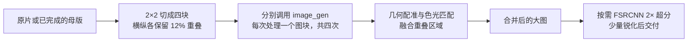

# Open Photo Workflow

中文 · [English](README.en.md)

**把照片拆成四块，分别交给 `image_gen` 处理，再配准拼成一张更大的成片。** 这是本仓库最想分享的方法，也给 ChatGPT Pro 的图像生成额度找点正经事做。

## 为什么要拆成四块：1536×1024 不够用

**1536×1024，只有约 150 万像素，发小红书都不够用。** 这是我们对成片细节和裁切余量的要求：照片还要能裁切、放大看人物和服装细节，不能修完只适合看缩略图。

我们在实际使用 Codex 内置 `image_gen` 时，多次拿到横版 **1536×1024**、竖版 **1024×1536** 的结果，准确计算约 157 万像素。对于相机拍摄的高分辨率照片，整张交给模型后，成片尺寸就成了瓶颈。四块方法让每次生成只负责原片的一部分，再把四份结果合并，减少单次整图输出尺寸带来的限制。

1536×1024 是本项目遇到的常见返回尺寸，不代表所有模型或版本都有固定上限。工作流按工具实际返回的尺寸处理。

## 核心方法：四块生成，再拼合与超分



1. **切块。** 保留原比例，切成左上、右上、左下、右下四块。横纵重叠区域均为整图对应尺寸的 12%，给配准和接缝融合留出空间。
2. **分别生成。** 每个图块单独交给 `image_gen`，沿用同一套摄影目标。默认只提供当前图块，确需上下文时再加全景参考；四次调用可按宿主能力并行。
3. **配准拼合。** 对齐各块几何，匹配重叠处的色彩与亮度，再融合边缘。合并尺寸依据各块实际输出计算，不先把画布补齐到固定 4K。
4. **合并后再超分。** 需要更大交付尺寸时，对合并图做 FSRCNN 2×，最后少量锐化。这样最终长边可以超过 4K。

以 3:2 横图、12% 重叠、四块均返回 1536×1024 为例，按几何比例估算：

| 阶段 | 尺寸示例 |
| --- | --- |
| 一次整图生成 | 1536×1024，约 157 万像素 |
| 四块配准合并 | 约 2743×1829，约 502 万像素 |
| 合并后 FSRCNN 2× | 约 5486×3658，约 2007 万像素 |

上表是尺寸计算示例，不是每次生成的保证。重叠区不能重复计数，实际尺寸还取决于原图比例、裁切取整和各块返回尺寸。更多输出像素也不等于恢复了同等数量的真实细节。

这条路线至少消耗四次生成，可能出现接缝或局部形变，适合希望提高成片尺寸、又接受少量生成瑕疵的任务。具体步骤见 [imagegen-tiled-upscale SKILL](skills/imagegen-tiled-upscale/SKILL.md)。仓库也分享整组照片规划、基础图准备、摄影提示词和直接调光方法；欢迎拿去改，补充好用的提示词和踩过的坑。

**代码仅供参考。安装 SKILL 不需要安装 Python 依赖，也不需要跑测试。** [reference-code/](reference-code/) 保留了本地处理的实现，供有需要的人阅读、修改或让 Agent 适配自己的环境。本仓库不包含任何照片或模型权重。

## 怎么用 Pro 额度修照片

用 ChatGPT Pro 账户登录 Codex，让 Agent 调用宿主提供的内置 `image_gen`，无需 OpenAI API Key。图像生成消耗订阅的共享使用额度，具体可用性和限制以账户为准，见 [OpenAI 官方说明](https://learn.chatgpt.com/docs/pricing)。

SKILL 告诉 Agent 如何组织工作，不提供图像服务，也不能增加额度。工具没有披露的模型型号、token 用量和原生分辨率，不作保证。其他 Agent 可以参考这套方法，但需要使用它们自己可用的图像工具。

## 工作流

1. **先看整组照片。** 根据题材、光线和用途确定风格。人像与静物可以采用不同思路，同拍 RAW/JPG 归组处理。
2. **准备基础图。** 优先使用可用的同拍 JPEG，其次是 RAW 内嵌 JPEG；两者原生长边至少 3840 像素，保留原比例。不够用，或需要 RAW 恢复曝光时，再显影。
3. **按目标选方法。** 只需光色调整就用本地工具。需要人像修饰、背景清理或生成式风格处理时，再调用 `image_gen`；整图尺寸不够用时采用四块生成与拼合。修脸、修身和移除物品都按用户要求；人物几何改动宜先整图完成，再分块增强。
4. **少量试片，再继续处理。** 熟悉的小批可直接做，新风格先用代表图校准。整图路线通常每张调用一次，四块路线通常每块调用一次；有具体问题再返工，合格样片直接复用。
5. **检查并交片。** 按用途选择超分和轻锐化，保留原生结果。按约定观看尺度检查，接受不影响观感的轻微瑕疵，处理明显的身份、肢体和关键文字错误。最后输出 JPG、简洁记录和静态对照相册。

LLM 主要负责摄影判断和例外。本地步骤尽量自动完成，不反复算哈希、不不断刷新相册，也不为了走流程制造多套中间文件。详细写法见 [摄影目标与提示词](skills/photo-workflow/references/photographic-goals.md)。

## 两项 SKILL

| SKILL | 用途 |
| --- | --- |
| [imagegen-tiled-upscale](skills/imagegen-tiled-upscale/SKILL.md) | 核心四块方法：拆分 → 四次生成 → 配准拼合 → 按需 2× 超分 |
| [photo-workflow](skills/photo-workflow/SKILL.md) | 整组照片的风格、基础图、处理方法、验收和交付 |

整图处理更省额度；四块处理用于需要更大成片和更好细节观感的任务。两条路线都不能把生成的小字或脸部纹理当作真实恢复。

## 交给 Agent 安装

把下面整段复制给能访问本地文件的 Agent：

```text
请从 https://github.com/hangxu/open-photo-workflow 安装两项 SKILL。
先阅读 README.md 和 INSTALL.md，再把 skills/photo-workflow 与
skills/imagegen-tiled-upscale 安装到当前 Agent 的技能目录。
Codex 在设置了 CODEX_HOME 时使用其 skills/ 子目录，否则使用 ~/.codex/skills/。
已有同名技能时先说明差异，不直接覆盖。
这次只安装 SKILL：不安装 Python 依赖，不跑测试，不处理或上传照片，不调用图像生成。
检查当前会话是否有内置 image_gen；没有就说明限制，不切换到付费 API、不索要 API Key。
完成后告诉我技能位置和调用方式。reference-code/ 只留作参考，实际修图需要本地工具时再按需准备。
```

手动安装见 [INSTALL.md](INSTALL.md)。README 和安装说明有中英文版本，SKILL 正文目前以中文为主。

安装后，可以直接让 Agent 尝试四块方法：

```text
使用 $imagegen-tiled-upscale 处理我指定的照片。
按 2×2 切成四块，横纵重叠各为整图对应尺寸的 12%。
每块分别调用内置 image_gen，使用统一风格，保留人物身份、姿态和构图。
完成后配准拼合，再对合并图做 FSRCNN 2× 超分和少量锐化，不先补齐到固定 4K。
保留四块原生结果、合并图和最终 JPG，记录实际尺寸；我接受轻微瑕疵。
缺少本地处理工具时先说明需要什么，再按我的任务准备，不改用付费 API。
```

处理整组照片时可以这样说：

```text
使用 $photo-workflow 处理我指定目录的照片，输出到新目录。
先看整组，按明亮自然的旅拍方向制定方案，保留人物本人特征。
修饰强度和需要移除的背景物品按我的要求。能直接调光的照片不要调用生成。
接受正常观看时不影响观感的轻微瑕疵。最后交付 JPG 和静态对照相册。
```

## 已知边界与分享方式

AI 可能改动人物、云层、背景纹理和小字；提示词能减少漂移，不能保证消除。超分尺寸不等于模型原生尺寸。原片应单独保留，调用图像工具会把选定图片发送给服务提供方。

欢迎用 Issue 或 PR 分享文字经验、脱敏参数和工作流改进。本仓库不收照片，包括预览、截图、生成图片和编码进文本的图片。见 [贡献说明](CONTRIBUTING.md)。

代码按 [MIT](LICENSE) 发布、按现状提供，不保证适用于所有设备和场景。[来源与许可说明](THIRD_PARTY_NOTICES.md) 列出了参考项目与外部工具。
